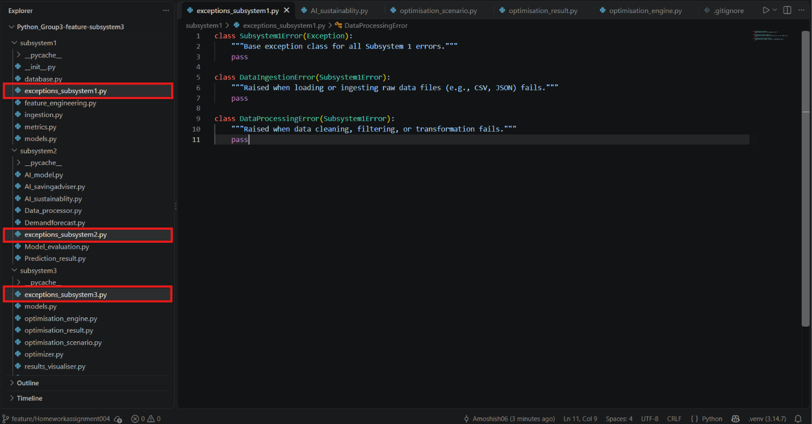
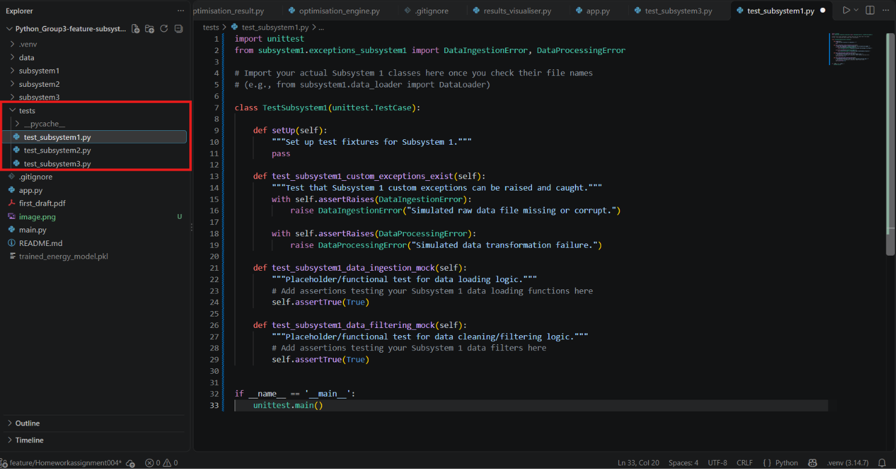

# Python_Group3
AI_Powered smart energy management system
Hometask4. Exception Handling and Unit tests

The highlighted files in the above image show the dedicated classes for exception handling

The 2nd image shows the dedicated folder in which there are test cases for automated unit tests
To execute the test cases for Unit testing, please execute the following command in the Terminal:
    "python -m unittest discover tests"
Link for the video file in which I have explained the task:
    https://www.loom.com/share/9c4df1187e6541a1b28f3fc676ecf162